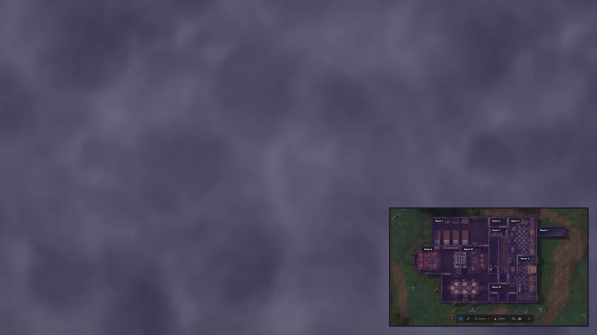
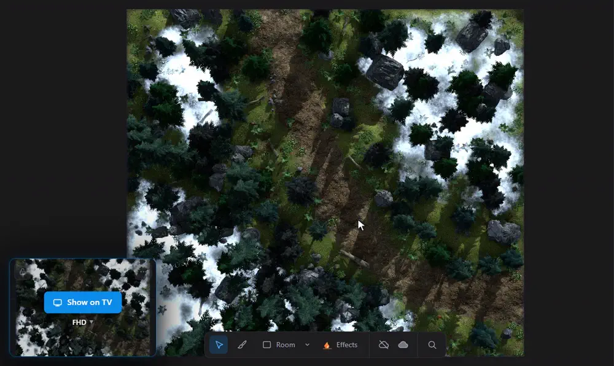
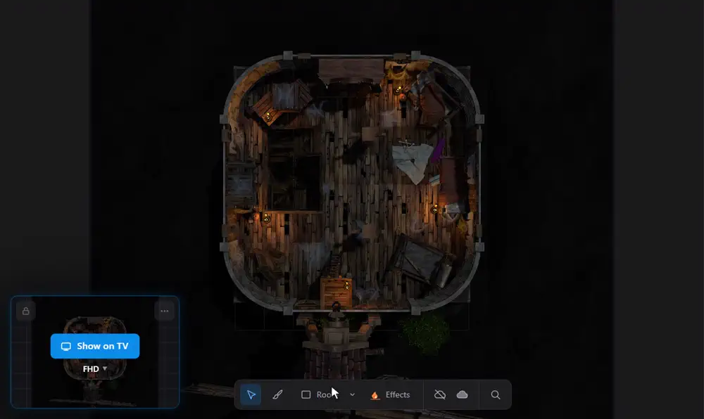
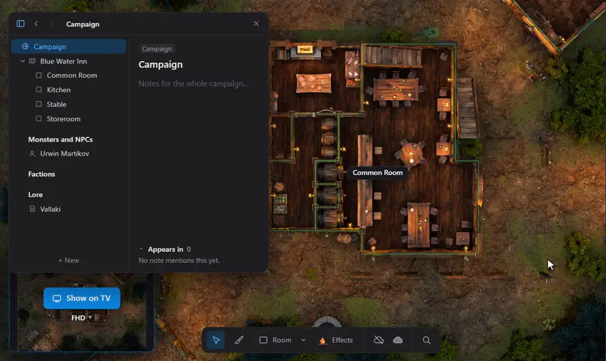
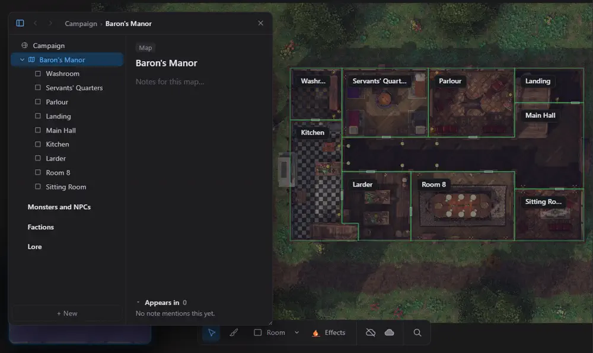
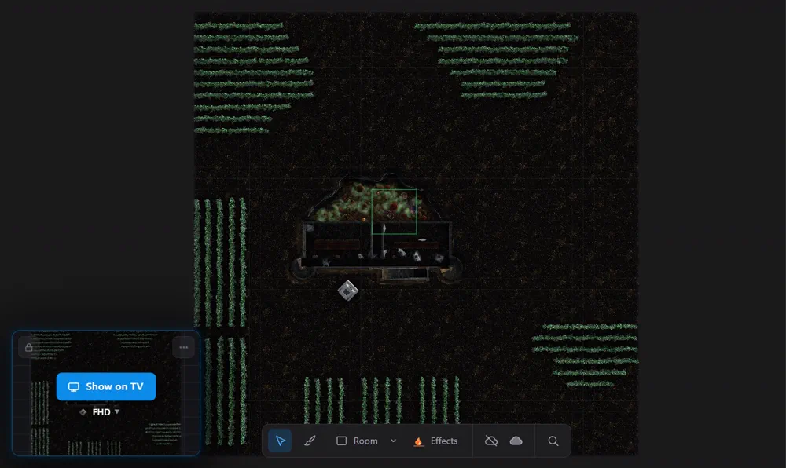
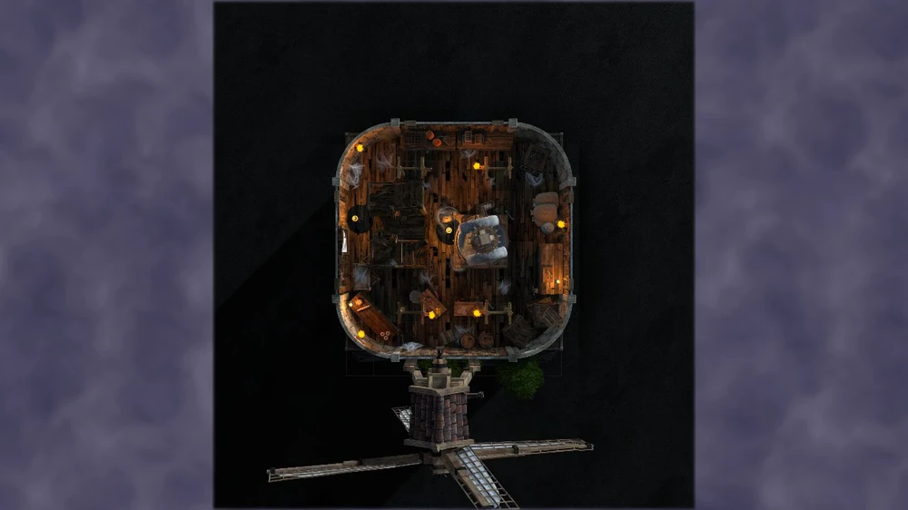

<p align="center"></p>

<h1 align="center">Evermist</h1>

<p align="center">
  <a href="../../releases/latest"></a>
  <a href="../../releases/latest"></a>
  <a href="LICENSE"></a>
</p>

Evermist is for DMs who run their games in person, with a TV on the table and minis on the map. You prepare and run everything from your laptop. The TV shows your players the map with fog of war, grid and effects. Evermist is free, and it will stay free, forever

If your group plays online, Evermist is not what you're looking for. Players don't connect to it, and it has no tokens and no dice

Evermist is built for D&D 5e, both the 2014 and the 2024 rules. A map from any game shows on the TV, a still picture or an animated MP4 or WebM, but module import and the bestiary read D&D books only



## Prepare the session

### Lay out your campaign

Every map sits on one board, the Campaign. Gather maps into groups, such as a town or a dungeon, and draw each group with the same tools you use for rooms. Join groups with roads, and put an encounter right on the road where it happens. Zoom out to see the whole campaign, and double-click a map to open it. Set a picture of your region behind it all

To move your prep to another computer, back up the whole campaign or only the maps you pick into one `.zip`, and restore it there



### Draw rooms of any shape

Draw a room with any outline you need. Double-click it to edit: drag corners and walls, curve a wall, round a corner, or cut a hole for a pillar. Join rooms together or cut one in two. Rooms can be copied, pasted, and moved between maps



#### Let the floor plan draw them

Some map editors can export a map's walls as a Universal VTT `.dd2vtt` file. Save that file in the same folder as the map, and Evermist offers to draw every room and door for you. It sizes the grid and places the map's lights from the same file

### Keep every note in one place

Notes open in their own window, next to a tree of your whole campaign: groups, maps, rooms, roads, monsters and NPCs, factions and lore. Pick anything in the tree, or a room on the map, and its note opens. Notes stay on your laptop and never reach the TV. Room names also show on your map

Type `@` in any note to link it to a room, a map, an NPC or a faction. Click the link to jump there. Every note ends with the notes that link to it, so an NPC's note lists every room that mentions the NPC



Keep pictures too, such as a portrait or a handout, and show one on the TV when the party gets there

#### Auto-fill notes from the module

If you run a published adventure, load it as a `.pdf` or `.txt`. Evermist finds every numbered location in the book, such as `K12. The Chapel`. Start typing "chapel" in a room's name field and pick it from the list. The room's name and description fill in from the book



### Fill your bestiary

The bestiary holds every monster you use. Paste a link to a monster's page, or load a monster book as a `.pdf`, and every stat block in it reads in. Search by name and filter by size, type and alignment. A stat block that doesn't read cleanly is left out and named, so you never get half a monster

### Set up the fog, the grid and the light

Each map keeps its own fog colour and movement. A dungeon can sit under navy mist and a swamp under a sickly green one. The grid can be square or hex, in any colour or width. To calibrate it to the map, drag across a few of the map's own cells. Room corners can snap to the grid as you draw

Lights pool inside their rooms and show on the TV only once the room is revealed. Draw them yourself, or let the floor plan place them

## Run the session

### Put the map on the TV

Connect the TV to your laptop over HDMI and press Show on TV. Evermist finds the TV and puts the map on it. If the TV only copies your laptop's screen, Evermist tells you how to make it a second screen. You can also show the map in a window and place it yourself

The minimap in the DM window shows which part of the map is on the TV. Drag it to move the TV's view. If you sit at the side of the table, My seat turns the map on your laptop to match your chair, and the TV stays as it is

### Reveal rooms as the party explores

Every room can be Shrouded, Revealed, or Half-shrouded for places the party visited but has left

Manual mode lets you prepare the next reveal in private. The TV doesn't update the picture until you press Send. Switching maps is animated with the fog, so the TV never goes black

To point at something, Ctrl+middle-click the map. A gold mark shows in the same spot on the TV

### Find anything with Ctrl+F

Press Ctrl+F anywhere and type. One search finds maps, rooms, notes, monsters, fights, music and pictures. Words found inside a note show under it, and an empty search lists what you opened last. Pick a room and its map opens with the room selected. In Auto mode, Evermist asks before the players see it



### Show two maps at once

When a fight spreads across two floors, or the party splits, show both maps side by side on the TV. Each map keeps its own fog and its own view, so no mini has to move when the other map changes



### Mark spell areas on the map

When a spell covers an area, draw it straight onto the map with the same tools you use for rooms, or pick a size from the presets. Circles, cones and walls of any shape all work. The grid stays visible inside the area, so everyone can count the squares it covers

### Run the fight from one table

Prepare your fights ahead, then run each one from a single table on your laptop. Every creature gets a row with its initiative, HP, AC, conditions and attacks, and its stat block opens with one click. Type damage as it lands and the table keeps the total. Pick a monster from your bestiary and its row fills in. Nothing from the fight reaches the TV

### Play music and sounds

Paste a YouTube video or playlist link during prep, and Evermist downloads the tracks to your laptop. At the table, pick a track and it fades in and loops until you choose another. Sort your tracks into groups

The Sounds pane plays a door creak, a crow or a bell over the music with one click

Press `?` in the DM window to see every keyboard shortcut

## Download

Download the latest version from [**Releases**](../../releases/latest):

| System | File | Notes |
|--------|------|-------|
| Windows | `Evermist-Setup-<version>.exe` | Installs in one click, then keeps itself up to date |
| macOS | `Evermist-<version>.dmg` | Universal (Intel and Apple Silicon). Drag it into Applications, then it keeps itself up to date |
| Linux | `Evermist-<version>.AppImage` | Make the file executable, then run. Keeps itself up to date |

An update downloads in the background and installs only when you press Restart to update

Evermist isn't code-signed (signing certificates cost money), so your OS shows a one-time security warning the first time you open it. It's harmless

<details>
<summary>Getting past the first-launch warning</summary>

- **Windows:** if "Windows protected your PC" appears, click "More info", then "Run anyway"
- **macOS:** if "Evermist can't be opened because Apple cannot check it…" appears, right-click the app, choose "Open", then "Open" again in the dialog. (A normal double-click won't offer this the first time.)
- **Linux:** make the AppImage executable (`chmod +x Evermist-*.AppImage`, or Properties → Permissions → Allow executing file as program), then run it as usual

The OS remembers your choice, so this only happens once
</details>

## Nothing leaves your computer

No account, no cloud, no tracking. Evermist goes online for three things only. The app checks GitHub for updates, a music link you paste downloads from YouTube, and a monster link you paste reads that page. Everything else works without an internet connection

Evermist works fully offline, and connecting an AI assistant is optional

Your maps and notes sit on your own disk. Module PDFs get read in a separate locked-down process that can't touch your files

## Running from source

No build step. It's plain JavaScript in an Electron shell

```bash
npm install     # one-time, after cloning
npm start       # launch the app
```

Build an installer for the current platform:

```bash
npm run build         # Windows installer .exe
npm run build:mac     # macOS .dmg
npm run build:linux   # Linux AppImage
```

GitHub Actions builds all three platforms and publishes the release (see [`.github/workflows/release.yml`](.github/workflows/release.yml))

Want to know how the fog rendering or the two-window sync works? [ARCHITECTURE.md](docs/ARCHITECTURE.md) explains it in plain English

## License

[MIT](LICENSE) - free to use, modify, and share

Have a great session
